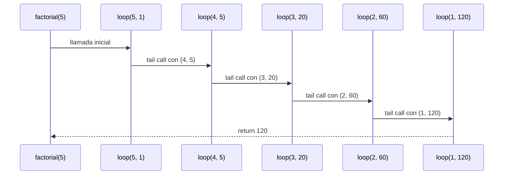
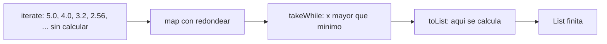
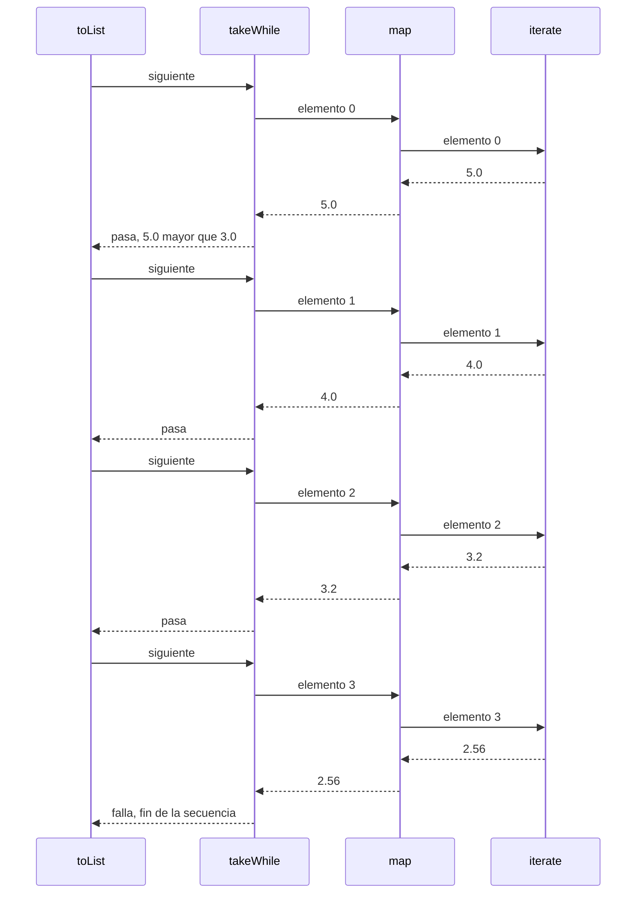
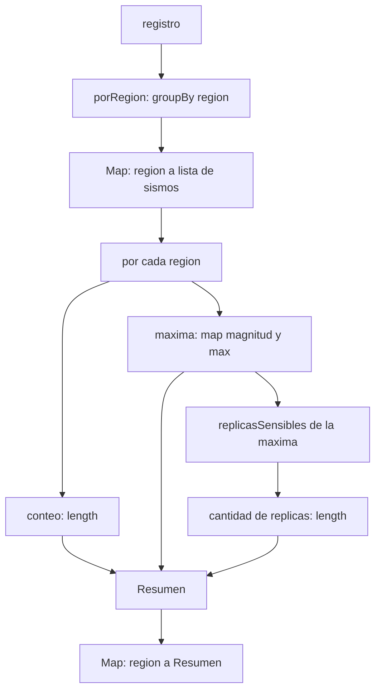

# Algoritmo Factorial con Recursión de Cola

## Definición del Algoritmo

```Scala
def factorial(n: Int): BigInt = {
  @annotation.tailrec
  def loop(x: Int, acumulador: BigInt): BigInt = {
    if (x <= 1) acumulador
    else loop(x - 1, acumulador * x)
  }
  loop(n, 1)
}
```

* La función `factorial` calcula el factorial de un número `n` utilizando **recursión de cola**.
* La función interna `loop` es la que hace la recursión:

  * Recibe dos parámetros:

    * `x`: el valor actual decreciente hasta llegar a 1.
    * `acumulador`: donde se guarda el resultado parcial en cada paso.
* El decorador `@annotation.tailrec` obliga a que la función sea optimizada como recursión de cola, es decir, **no se acumulan llamados en la pila**.

## Explicación paso a paso

### Caso base

```Scala
if (x <= 1) acumulador
```

Cuando `x` llega a `1`, la función retorna directamente el valor acumulado, evitando más llamadas.

### Caso recursivo

```Scala
loop(x - 1, acumulador * x)
```

En cada llamada:

* Se reduce el valor de `x` en 1.
* Se multiplica el acumulador por `x` y se pasa a la siguiente iteración.
* Como es recursión de cola, la llamada recursiva es la **última instrucción** en ejecutarse, lo que permite a Scala optimizar la pila.

---

## Llamados de pila en recursión de cola

Ejemplo:

```Scala
factorial(5)
```

### Paso 1: Llamada inicial

```Scala
loop(5, 1)
```

### Paso 2: Primera iteración

```Scala
loop(4, 5)   // acumulador = 1 * 5
```

### Paso 3: Segunda iteración

```Scala
loop(3, 20)  // acumulador = 5 * 4
```

### Paso 4: Tercera iteración

```Scala
loop(2, 60)  // acumulador = 20 * 3
```

### Paso 5: Cuarta iteración

```Scala
loop(1, 120) // acumulador = 60 * 2
```

### Paso 6: Caso base

```Scala
return 120
```

---

## Diferencia con recursión normal

* En **recursión normal** cada llamada queda en la pila esperando a que termine la siguiente, lo que puede causar desbordamiento si `n` es muy grande.
* En **recursión de cola**, el compilador transforma el proceso en un **bucle optimizado**, por lo que no se guarda cada llamada en la pila y el algoritmo puede ejecutarse para valores muy grandes sin problema.

---

## Ejemplo de uso

```Scala
val resultado = factorial(5)
println(resultado)  // 120
```

El resultado de `factorial(5)` es `120`.


## Diagrama de llamados de pila con recursión de cola



## Punto 4: réplicas perezosas
### Código

```scala
def replicas(magnitud: Double): LazyList[Double] = {
  def redondear(x: Double): Double = Math.round(x * 100.0) / 100.0
  LazyList.iterate(magnitud)(_ * 0.8).map(redondear)
}

def replicasSensibles(magnitud: Double, minimo: Double): List[Double] = {
  replicas(magnitud).takeWhile(_ > minimo).toList
}
```

### Qué hace cada operación

* `LazyList.iterate(magnitud)(_ * 0.8)` produce la secuencia infinita
  `magnitud, magnitud * 0.8, magnitud * 0.8 * 0.8, ...`. Es **perezosa**: guarda
  el primer valor y una "receta" para calcular el resto, pero no lo calcula.
* `.map(redondear)` redondea a dos decimales. En un `LazyList`, `map`
  también es perezoso: no recorre nada, solo anota que cada elemento, cuando
  se pida, debe pasar por `redondear`.
* `.takeWhile(_ > minimo)` entrega los elementos desde el principio y se
  detiene en el primero que **no** supera el mínimo. No mira ninguno después.
* `.toList` es lo que obliga a calcular. Recorre lo que `takeWhile` deja pasar
  y lo guarda en una lista normal, que ya es finita.
* `.take(4)` (en las pruebas) entrega los primeros cuatro elementos.

El redondeo se hace **después** de `iterate`, no dentro. Así cada valor sale de
multiplicar la magnitud original por $0.8^k$ y se redondea una sola vez; si se
redondeara en cada paso, el error se acumularía de réplica en réplica.

### Expresiones `for`

En los puntos 4 y 5 **no se usó ninguna expresión `for`**: la secuencia se
construye con `iterate`, `map` y `takeWhile`, que ya describen el _qué_ sin
recorrer nada a mano. No hay ciclos, `var`, `while` ni `return`.

### Ejecución paso a paso: `replicas(5.0).take(4).toList`

Los valores "crudos" son los que produce `iterate`; los "redondeados" son los
que salen de `map`.

| Posición $k$ | Valor crudo | Valor redondeado | ¿Se calcula? |
|:---:|:---:|:---:|:---|
| 0 | 5.0 | 5.0 | Sí |
| 1 | 4.0 | 4.0 | Sí |
| 2 | 3.2 | 3.2 | Sí |
| 3 | 2.5600000000000005 | 2.56 | Sí |
| 4 | 2.048... | 2.05 | **No**, `take(4)` ya no lo pide |
| 5, 6, ... | ... | ... | **No** |

Resultado: `List(5.0, 4.0, 3.2, 2.56)`. Se calculan exactamente cuatro
elementos, aunque la secuencia no termine nunca.

### Ejecución paso a paso: `replicasSensibles(5.0, 3.0)`

1. `replicas(5.0)` crea la secuencia, sin calcular ningún elemento.
2. `takeWhile(_ > 3.0)` se arma, todavía sin calcular nada.
3. `toList` pide el primer elemento: se calcula `5.0`. Como $5.0 > 3.0$, pasa.
4. Pide el segundo: `4.0`. Como $4.0 > 3.0$, pasa.
5. Pide el tercero: `3.2`. Como $3.2 > 3.0$, pasa.
6. Pide el cuarto: `2.56`. Como $2.56 > 3.0$ es falso, `takeWhile` **se detiene**.
   El quinto elemento nunca se calcula.
7. `toList` entrega `List(5.0, 4.0, 3.2)`.

Caso borde, `replicasSensibles(2.0, 3.0)`: el primer elemento es `2.0`, no
supera `3.0`, `takeWhile` se detiene de inmediato y el resultado es `List()`.
Solo se calculó un elemento.

### Por qué la secuencia infinita no agota la memoria

Una secuencia infinita **no cabe** en memoria si se construye completa; esta
nunca se construye completa. Hay tres razones:

1. **Cada elemento se calcula solo cuando alguien lo pide.** Un `LazyList` es
   una celda con la cabeza ya calculada y la cola como un cálculo pendiente.
   Mientras nadie pida la cola, ocupa una cantidad fija de memoria.
2. **`takeWhile` deja de pedir elementos apenas falla la condición.** Si hay
   $n$ réplicas sensibles, se calculan $n + 1$ elementos: los $n$ que pasan y
   el primero que falla. El resto de la secuencia, infinito, nunca existe. Con
   `take(4)` se calculan exactamente 4.
3. **`replicasSensibles` no guarda la secuencia.** `replicas(magnitud)` es una
   expresión intermedia que nadie conserva en una `val`; cuando `toList`
   termina, el resultado es una `List` finita de $n$ elementos y las celdas
   intermedias quedan libres para el recolector de basura. La memoria usada es
   proporcional a $n$, no al largo de la secuencia.

Una `List` normal no podría hacer esto: pedir "la lista infinita" calcularía
elementos para siempre y se agotaría la memoria. Por la misma razón, **nunca**
se debe llamar a `toList`, `size` o `foreach` sobre `replicas(m)` sin antes
limitarla con `take` o `takeWhile`.

### Diagramas

Cadena de transformaciones (nada se calcula hasta `toList`):



Orden en que se piden los elementos en `replicasSensibles(5.0, 3.0)`:



---

## Punto 5: informe combinado
### Código

```scala
def informe(r: Registro, minimo: Double): Map[String, Resumen] = {
  porRegion(r).map { case (region, sismos) =>
    val maxima = sismos.map(_.magnitud).max
    region -> Resumen(sismos.length, maxima, replicasSensibles(maxima, minimo).length)
  }
}
```

`informe` no calcula nada por su cuenta: combina `porRegion` (punto 2) para
agrupar y `replicasSensibles` (punto 4) para contar las réplicas.

### Qué hace cada parte

* `porRegion(r)` es `r.groupBy(sismo => sismo.region)`: un
  `Map[String, List[Sismo]]` con una entrada por cada región que aparece en el
  registro.
* `.map { case (region, sismos) => ... }` visita cada entrada del mapa. El
  `case (region, sismos)` separa la llave del valor.
* `sismos.length` es el conteo de sismos de la región.
* `sismos.map(_.magnitud).max` es la magnitud máxima. Nunca falla por lista
  vacía, porque `groupBy` solo crea una región si tiene al menos un sismo.
* `replicasSensibles(maxima, minimo).length` cuenta las réplicas sensibles del
  sismo más fuerte de la región.
* `region -> Resumen(...)` crea el par `(region, Resumen(...))`. Un `map` sobre
  un `Map` que devuelve pares produce otro `Map`.

### Expresiones `for`

No se usó `for`. Si se escribiera con `for`, sería:

```scala
for ((region, sismos) <- porRegion(r)) yield {
  val maxima = sismos.map(_.magnitud).max
  region -> Resumen(sismos.length, maxima, replicasSensibles(maxima, minimo).length)
}
```

y el compilador lo traduce a `porRegion(r).map { case (region, sismos) => ... }`,
que es justo la versión que se entregó (con un generador y `yield` solo
aparece `map`; el patrón de tupla puede añadir un `withFilter` que deja pasar
todo).

### Ejecución paso a paso: `informe(registro, 3.0)`

1. `porRegion(registro)` agrupa los siete sismos:

   | Región | Sismos (magnitudes) |
      |---|---|
   | Valle | 4.2, 3.8, 5.3 |
   | Santander | 5.1, 4.7 |
   | Choco | 6.0, 3.1 |

2. Para cada región se calcula el resumen:

   | Región | Conteo | Máxima | Réplicas de la máxima (mayores que 3.0) | Cantidad |
      |---|:---:|:---:|---|:---:|
   | Valle | 3 | 5.3 | 5.3, 4.24, 3.39 (la siguiente, 2.71, no pasa) | 3 |
   | Santander | 2 | 5.1 | 5.1, 4.08, 3.26 (la siguiente, 2.61, no pasa) | 3 |
   | Choco | 2 | 6.0 | 6.0, 4.8, 3.84, 3.07 (la siguiente, 2.46, no pasa) | 4 |

3. Se arman los pares y el `map` los reúne en un solo mapa:
   `Map("Valle" -> Resumen(3, 5.3, 3), "Santander" -> Resumen(2, 5.1, 3), "Choco" -> Resumen(2, 6.0, 4))`.

Caso borde, `informe(List(), 3.0)`: `groupBy` sobre una lista vacía da un mapa
vacío, el `map` no tiene entradas que visitar, y el resultado es `Map()`.

Observación: el orden en que se muestran las regiones dentro del `Map` no es
parte del resultado. Dos mapas con las mismas llaves y los mismos valores son
iguales sin importar cómo se impriman.

### Diagrama




