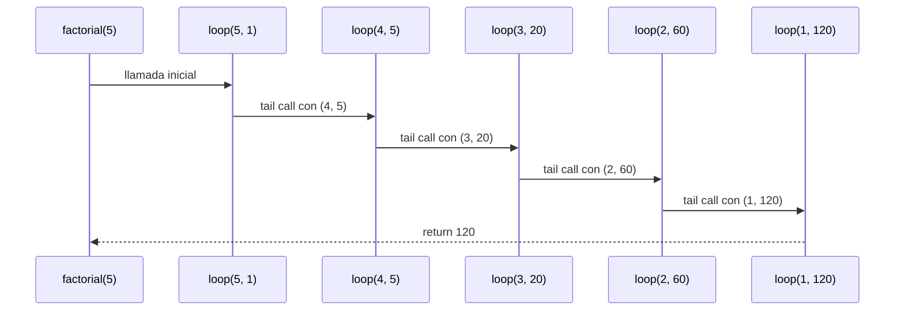
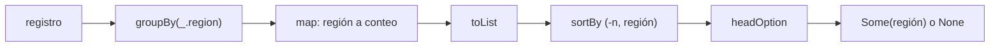

# Algoritmo Factorial con Recursión de Cola

## Definición del Algoritmo

```Scala
def factorial(n: Int): BigInt = {
  @annotation.tailrec
  def loop(x: Int, acumulador: BigInt): BigInt = {
    if (x <= 1) acumulador
    else loop(x - 1, acumulador * x)
  }
  loop(n, 1)
}
```

* La función `factorial` calcula el factorial de un número `n` utilizando **recursión de cola**.
* La función interna `loop` es la que hace la recursión:

  * Recibe dos parámetros:

    * `x`: el valor actual decreciente hasta llegar a 1.
    * `acumulador`: donde se guarda el resultado parcial en cada paso.
* El decorador `@annotation.tailrec` obliga a que la función sea optimizada como recursión de cola, es decir, **no se acumulan llamados en la pila**.

## Explicación paso a paso

### Caso base

```Scala
if (x <= 1) acumulador
```

Cuando `x` llega a `1`, la función retorna directamente el valor acumulado, evitando más llamadas.

### Caso recursivo

```Scala
loop(x - 1, acumulador * x)
```

En cada llamada:

* Se reduce el valor de `x` en 1.
* Se multiplica el acumulador por `x` y se pasa a la siguiente iteración.
* Como es recursión de cola, la llamada recursiva es la **última instrucción** en ejecutarse, lo que permite a Scala optimizar la pila.

---

## Llamados de pila en recursión de cola

Ejemplo:

```Scala
factorial(5)
```

### Paso 1: Llamada inicial

```Scala
loop(5, 1)
```

### Paso 2: Primera iteración

```Scala
loop(4, 5)   // acumulador = 1 * 5
```

### Paso 3: Segunda iteración

```Scala
loop(3, 20)  // acumulador = 5 * 4
```

### Paso 4: Tercera iteración

```Scala
loop(2, 60)  // acumulador = 20 * 3
```

### Paso 5: Cuarta iteración

```Scala
loop(1, 120) // acumulador = 60 * 2
```

### Paso 6: Caso base

```Scala
return 120
```

---

## Diferencia con recursión normal

* En **recursión normal** cada llamada queda en la pila esperando a que termine la siguiente, lo que puede causar desbordamiento si `n` es muy grande.
* En **recursión de cola**, el compilador transforma el proceso en un **bucle optimizado**, por lo que no se guarda cada llamada en la pila y el algoritmo puede ejecutarse para valores muy grandes sin problema.

---

## Ejemplo de uso

```Scala
val resultado = factorial(5)
println(resultado)  // 120
```

El resultado de `factorial(5)` es `120`.


## Diagrama de llamados de pila con recursión de cola



## Punto 3: consultas seguras

Código del punto (en `RegistroSismico.scala`):

```scala
def conteoSeguro(r: Registro): Map[String, Int] =
  r.groupBy(_.region).map { case (region, sismos) => (region, sismos.length) }
    .withDefaultValue(0)

def maximaDe(r: Registro, region: String): Option[Double] =
  (for (s <- r if s.region == region) yield s.magnitud).maxOption

def regionMasActiva(r: Registro): Option[String] =
  r.groupBy(_.region).map { case (region, sismos) => (region, sismos.length) }
    .toList.sortBy { case (region, n) => (-n, region) }
    .headOption.map { case (region, _) => region }
```

Las tres funciones evitan las excepciones de dos maneras: `conteoSeguro` le da
al mapa un valor por defecto, y `maximaDe` y `regionMasActiva` devuelven un
`Option` en lugar de fallar cuando no hay respuesta. No se usa `var`, `while`
ni `return`.

### Traducción de la expresión `for` de `maximaDe`

El `for` con `if` y `yield` no es una construcción propia: el compilador la
traduce a `withFilter` y `map`.

```scala
for (s <- r if s.region == region) yield s.magnitud
```

se traduce a

```scala
r.withFilter(s => s.region == region).map(s => s.magnitud)
```

El guarda `if` pasa a `withFilter` y el `yield` pasa a `map`. Después,
`maxOption` toma la lista de magnitudes: si está vacía devuelve `None` y si no
lo está devuelve `Some` del mayor.

### Traza de `conteoSeguro(registro)`

Con el registro de siete sismos del material:

1. `r.groupBy(_.region)` agrupa los sismos por región:

   | región | sismos del grupo |
      |---|---|
   | `"Valle"` | 3 sismos (4.2, 3.8, 5.3) |
   | `"Santander"` | 2 sismos (5.1, 4.7) |
   | `"Choco"` | 2 sismos (6.0, 3.1) |

2. `.map { case (region, sismos) => (region, sismos.length) }` reemplaza cada
   grupo por su tamaño: `Map("Valle" -> 3, "Santander" -> 2, "Choco" -> 2)`.
3. `.withDefaultValue(0)` envuelve ese mapa. Las claves que están siguen
   respondiendo su conteo, y toda clave que no está responde `0` en lugar de
   lanzar `NoSuchElementException`.

Entonces `conteoSeguro(registro)("Valle")` da `3` y
`conteoSeguro(registro)("Amazonas")` da `0`. El valor por defecto solo actúa
con `apply`: `contains("Amazonas")` sigue siendo `false`, porque la clave no
se agrega al mapa.

### Traza de `maximaDe(registro, "Choco")` y `maximaDe(registro, "Amazonas")`

| llamada | magnitudes de la región (`for`) | `maxOption` |
|---|---|---|
| `maximaDe(registro, "Choco")` | `List(6.0, 3.1)` | `Some(6.0)` |
| `maximaDe(registro, "Amazonas")` | `List()` | `None` |

### Traza de `regionMasActiva(registro)`

1. Se agrupa y se cuenta como en `conteoSeguro`, y se pasa a lista de parejas.
   El orden de esa lista no está garantizado por el mapa, por ejemplo:
   `List(("Santander", 2), ("Valle", 3), ("Choco", 2))`.
2. `sortBy { case (region, n) => (-n, region) }` ordena por conteo
   descendente (por eso el signo menos) y, en empate, por nombre ascendente:
   `List(("Valle", 3), ("Choco", 2), ("Santander", 2))`.
3. `headOption` toma la primera pareja, `Some(("Valle", 3))`, y la última
   transformación se queda con el nombre: `Some("Valle")`.

Con el registro vacío no hay grupos, la lista está vacía y `headOption` da
`None`.




